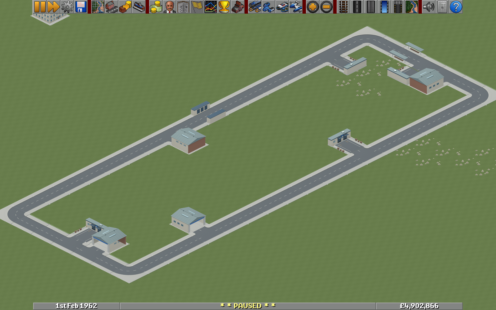

# Atelier: temperate art and full fleet

Road and rail approaches now join their bridge decks, depots have rebuilt entrances, and cargo stops have loading buildings. Towns, industries, airports, vegetation, track details, fields and foundations follow the approved miniature European art direction. Approved houses and the imported Future Heritage fleet are preserved.

This source PR includes the earlier Atelier road/house tooling and full fleet importer because those were not yet on `main`. It adds 1,224 temperate model-view collections and 1,717 logical sprite replacements, with indexed fallback and 32-bit normal, 2x and 4x zoom alternatives. These counts include directions, construction/growth states and sorting fragments; they are not counts of distinct building designs. The supplied fleet contains 256 base models and 88 empty variants.

- [Native screenshot review](review.md): bridges, depots, cargo buildings, roads, fleet and wider world.
- [Rebuild and integration](rebuild.md): required inputs, commands, load order and collation boundaries.
- [Coverage and retained assets](evidence/audit-summary.json), [all sprite assignments](evidence/coverage.json), and [complete source-slot audit](evidence/temperate-asset-audit.csv).
- [Recorded validation](evidence/validation.json), [native movement](evidence/verification/bridge-traffic.json), [save roundtrip](evidence/verification/compatibility.json), and [artifact hashes](evidence/delivery-manifest.json).
- [Art direction](art-bible.md), [historical checkpoints](checkpoint-history.md), and [provenance](evidence/provenance.json).

The checked-in review images are actual native screenshots, not concept art. The editable Blender libraries, compiled GRFs, supplied 118 MB archive, and portable runtime remain generated/external artifacts. Their exact paths, sizes and SHA-256 values are recorded in the delivery manifest. In the original workspace, open `artifacts/atelier-temperate/review.html` or `artifacts/atelier-temperate/runtime/Launch-Atelier-Demo.cmd`. Workspace-only links in the historical documents require those local bundles.

The game uses baked sprites from genuine editable meshes. This PR does not change the renderer, economy, vehicle properties, save schema or normal launcher. The optional developer helper patch is used only to author and inspect the isolated review fixture. It is not applied to the game by this PR. See the rebuild guide before combining this art with the separate regional-development and live vehicle-renderer branches.

Recorded native validation covers 256 vehicle IDs and 2,048 resolved views with unchanged vehicle properties, nine moving powered vehicles, bridge traversal, and a baseline-engine save roundtrip. All 1,224 model views have nonempty, unclipped bounds and mask files; all three new Blender libraries reopen without missing resources. Paired measurements describe the 128 x 128 fixture, not dense-city stress testing. The [performance context](evidence/verification/performance-context.json) records the final buoy alias added after the benchmark; the final pack was loaded and save-roundtripped afterward.

Arctic, tropical and Toyland are deferred. Catenary/contact overlays, technical waterway edges and aqueducts, small effects, disaster art and interface graphics are explicitly retained. Native captures cover representative scenes, not every bridge length and terrain combination. Imported helicopter rotors remain static in their body sprites.

New code and procedural art are AI-assisted and distributed under the repository's GPL-2.0-only terms, without a claim of exclusive rights in generated material. OpenGFX-derived masks and inherited artwork retain their notices; see [OpenGFX licence](evidence/OpenGFX-LICENSE.txt), [authors](evidence/OpenGFX-authoroverview.csv), and the project [third-party notices](../THIRD_PARTY_NOTICES.md). The external fleet archive retains its own supplied notices.
