# Native art review

All images below are unmodified 1600 x 1000 screenshots from the native game. The temperate captures record the reviewed world artwork; [performance context](evidence/verification/performance-context.json) identifies the final buoy alias and subsequent refreshed captures. The road and fleet captures record their earlier approved checkpoints.

## Cargo buildings and depots

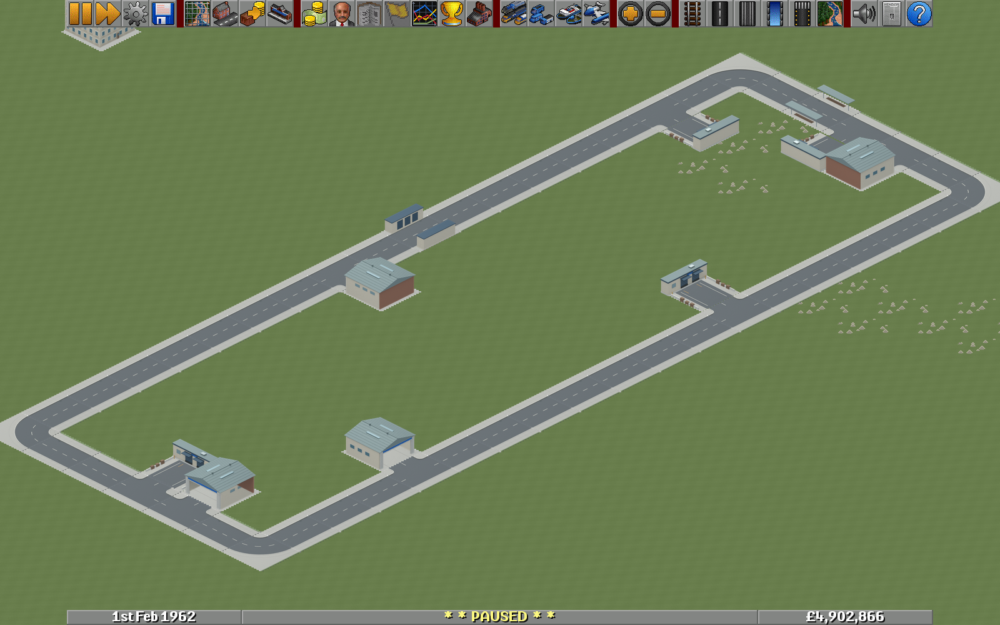

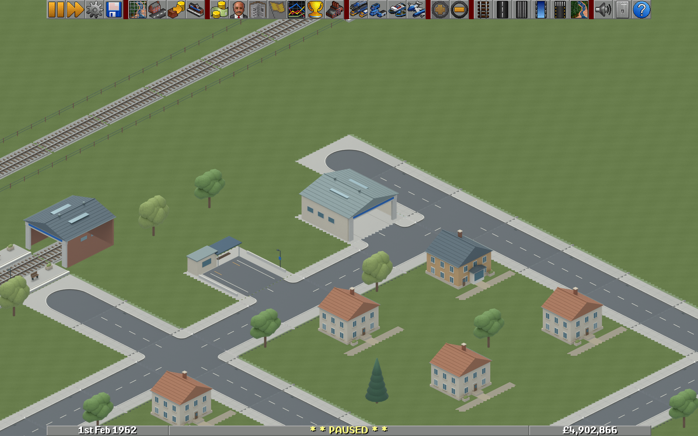

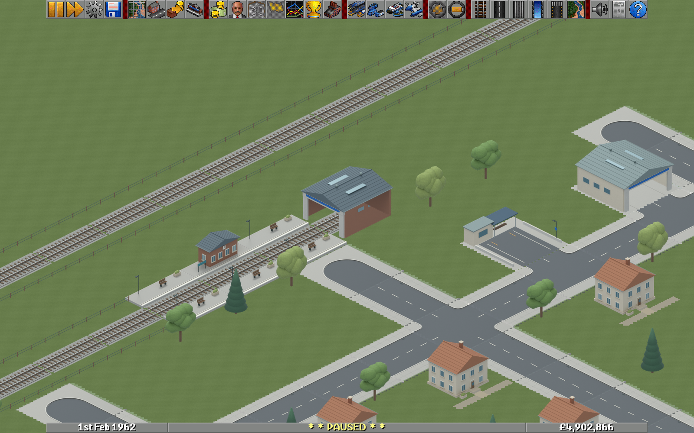

## Continuous bridge approaches

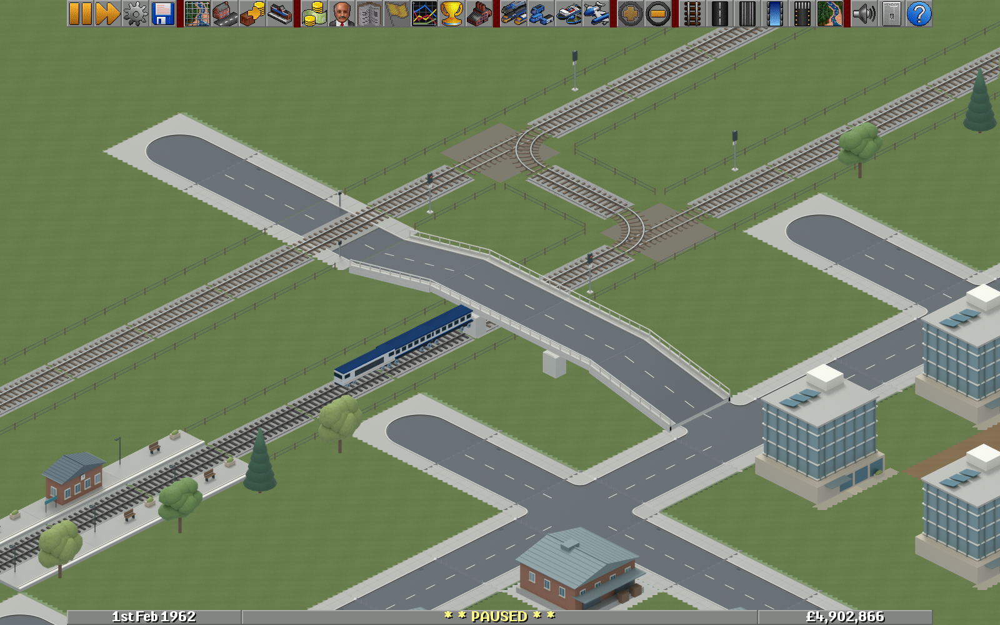

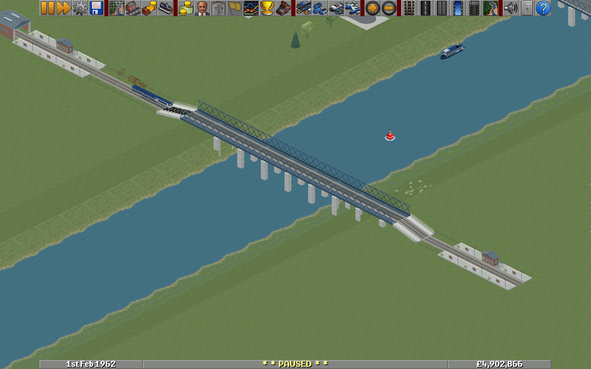

## World assets

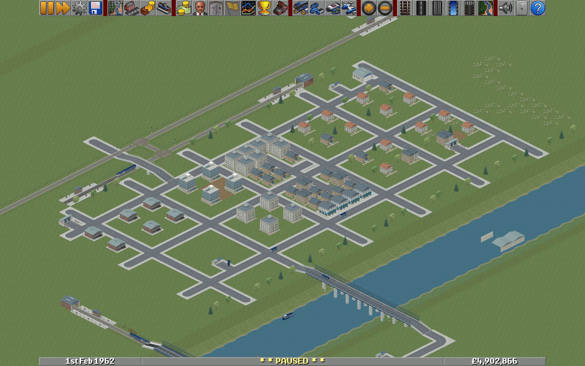

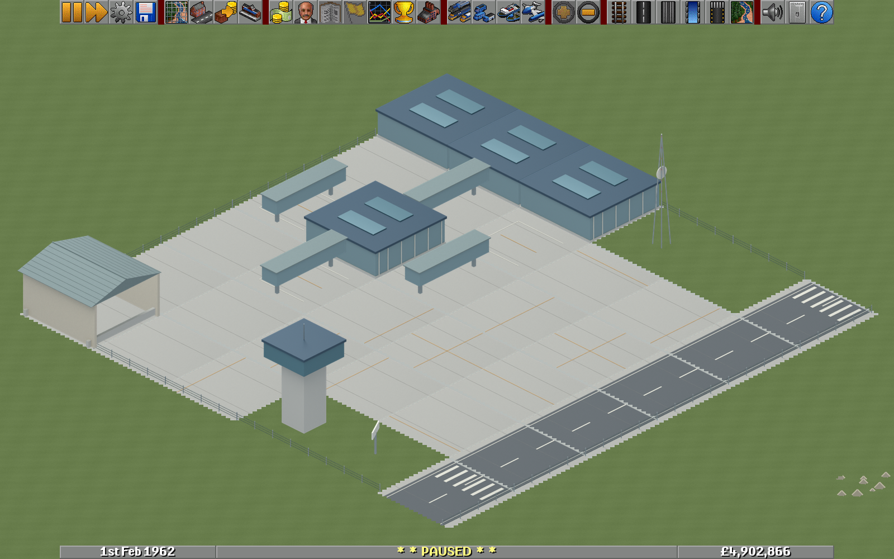

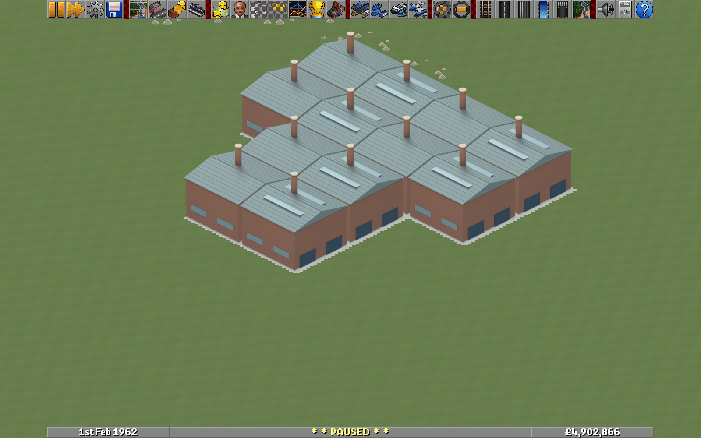

## Preserved road and fleet checkpoints

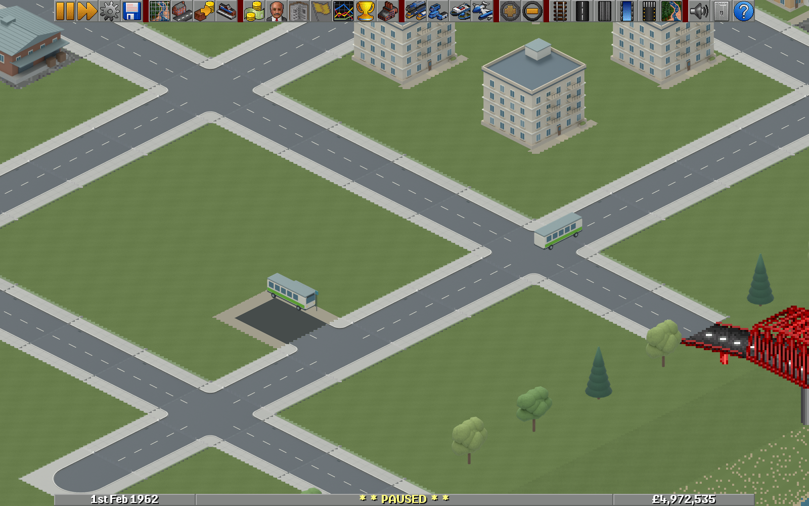

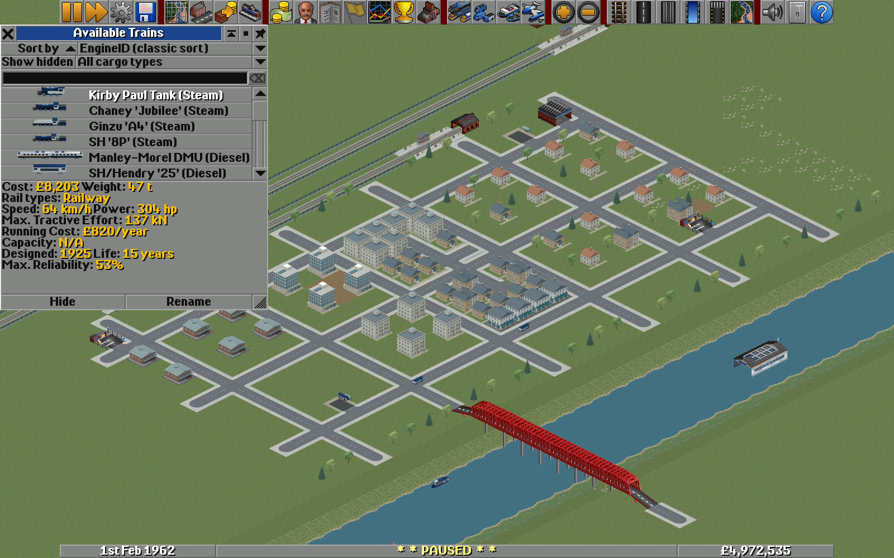

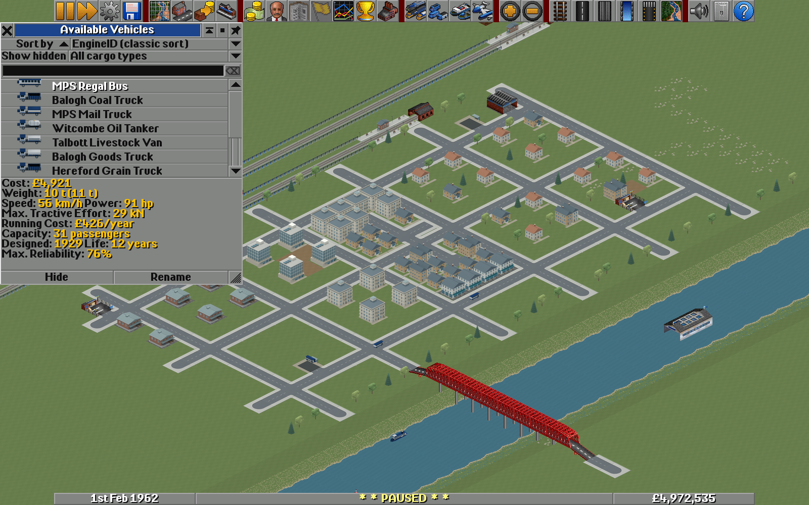

Full local review galleries also include source-model browsers, eight-direction fleet states, additional industries, both bridge axes and indexed fallback. See [rebuild and integration](rebuild.md) for the workspace layout and delivery manifest. Source-render previews in those galleries are explicitly labelled separately from native captures.
